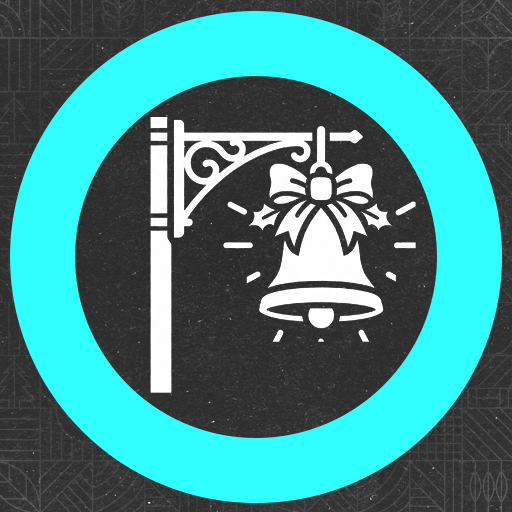

# Seasonal Street Lights

**Decorate the whole town for the season - in one click.**

A Farming Simulator 25 mod by RocklandUSA Gaming. It hangs illuminated decorations on the map's own street lights: snowflakes, trees, bells and gift boxes at Christmas, fireworks at New Year, lanterns for Lunar New Year, masks and feathers for Carnival, tulips in spring, a summer fair, a harvest festival, friendly pumpkins and ghosts at Halloween, and a Farm life set for any time of year.

> **Download:** Seasonal Street Lights is distributed only through the official GIANTS ModHub. This repository holds the documentation and the issue tracker. The mod files are not available here.

## Features

- **10 themes, 41 designs.** Every design is a real light display: rope lights that glow and bulbs that twinkle on their own.
- **Lit like the street lights.** Softly lit by day and bright at night. They switch on with the map's street lights.
- **No placing.** The decorations are found automatically on every street light of the base-game maps, mounted under the lamp and facing the road. Lamp posts with lamps on several sides get a matching pair.
- **The same for everyone.** In multiplayer every player sees the same decoration on the same pole.
- **Purely visual.** No collision and no effect on traffic or vehicles.
- **Languages:** English, German, French and Polish.

## Themes

| Theme | Calendar dates (northern hemisphere) |
|---|---|
| New Year | 27 December to 6 January |
| Winter | 7 January to the end of February |
| Lunar New Year | 15 days from its real date each year (real calendar only) |
| Carnival | The 10 days up to Carnival Tuesday (real calendar: its real date each year) |
| Spring | March to May |
| Summer | June to August |
| Harvest | September to mid-October, and November |
| Halloween | 15 to 31 October |
| Christmas | 1 to 26 December |
| Farm life | Manual only, any time of year |

South of the equator Winter, Spring, Summer and Harvest move by six months, and Halloween is manual only.

## Settings

Open **Mod Settings with F6**.

**Schedule** - how the theme changes:

- **Manual:** pick a theme and it stays.
- **Game calendar:** follows the in-game date, so Christmas comes in December and Halloween in late October.
- **Real calendar:** follows today's real date, with Lunar New Year and Carnival on their real dates every year.

A new save starts on the real calendar, so today's theme is already up when you load in.

**Skip themes** - on the THEMES tab, set any theme to SKIPPED (for example Carnival) and the calendar passes over it. The theme before it simply stays up longer. Manual mode ignores this list.

**Hemisphere** - *Auto* reads the map. South of the equator the seasons flip: winter decorations come in June and the summer fair in January. Christmas, New Year and Carnival keep their dates.

Only one theme shows at a time. In multiplayer only the server admin can change the settings.

## Maps

The decorations attach to the base-game street-light models, so they work on the base-game maps (Riverbend Springs, Zielonka, Hutan Pantai, Kinlaig) and on the Beans & Alpacas map Catuai. Mod maps that reuse the base-game street lights are decorated too. Maps with their own custom lamp models are left undecorated.

To check a map, open the developer console and run `hslScan`. It lists every street-lamp type on the map and whether it is decorated. If a lamp type on your map is not matched, please open an issue with that output.

## Console commands

| Command | What it does |
|---|---|
| `hslStatus` | What is shown, the schedule and the hemisphere |
| `hslScan` | Every street-lamp type on this map and whether it is decorated |
| `hslRescan` | Finds every street light again, for example after placing new ones |
| `hslShowcase [radius\|off]` | Poles near you cycle through every design of the current theme (for screenshots) |

## FSCore

Seasonal Street Lights is also part of FSCore (Map Essentials > SEASONAL). When FSCore is installed this mod stays inactive and FSCore's version runs, so you never get two sets of decorations.

## Reporting a problem

Open an [issue](../../issues/new/choose) and include:

- the mod version and the map
- singleplayer or multiplayer
- the lines containing `[HolidayStreetLights]`, `Error` or `Warning` from `Documents\My Games\FarmingSimulator2025\log.txt`

## License

Copyright (C) 2026 RocklandUSA Gaming. All rights reserved. See [LICENSE](LICENSE).
